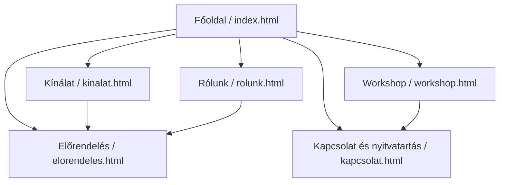

# Hajnal Kovászos Pékség – weboldalterv

Állapot: egyeztetett oldaltérkép és szakaszstruktúra; a szövegirány szerkesztés alatt, 2026. november 12.  
Forrás: `brief-3-pekseg.md`, `Vizsgamunka.md`, a `képek/` mappa.

Választott arculat: [D – Hajnali retró](design-system-hibrid.md). A három főoldali tervből a **2. retró plakát** elrendezést választottuk; a teljes statikus oldal a `weboldal/hajnal-site/` mappában épül.

## 1. Kiindulás és cél

A Hajnal Kovászos Pékség egy fiktív pécsi pékség és 12 férőhelyes reggeliző. Varga Marci süt, Varga Lili a boltot viszi. A weboldal elsődleges célja az egész kenyérre és tortára érkező előrendelések növelése. A látogatók gyorsan találják meg a nyitvatartást és a helyet. A havi kovászkészítő workshop külön, másodlagos útvonalat kap.

**Fő felhasználói utak:**
1. Megnézem a kínálatot → kiválasztom a kenyeret vagy tortát → előrendelem → bolti átvétel és fizetés.
2. Megnézem, nyitva vannak-e → megkeresem a címet → odamegyek reggelizni.
3. Megismerem a workshopot → jelentkezem vagy érdeklődöm.

## 2. Oldaltérkép

- **Főoldal:** röviden bemutatja a pékséget és a két fő felhasználói utat. Fő akció: „Előrendelek”.
  - **Kínálat:** kenyér, péksütemény, reggeli, torta kategóriák. Fő akció: „Előrendelek kenyeret vagy tortát”.
  - **Előrendelés:** feltételek és űrlap. Fő akció: „Elküldöm az előrendelést”.
  - **Rólunk:** Marci és Lili története, a kovászos szemlélet. Fő akció: „Megnézem a kínálatot”.
  - **Workshop:** a havi alkalom bemutatása. Fő akció: „Érdeklődöm a következő alkalomról”.
  - **Kapcsolat és nyitvatartás:** cím, nyitvatartás, elérhetőség, útvonal. Fő akció: „Útvonalat tervezek”.

**Globális navigáció:** Főoldal, Kínálat, Rólunk, Workshop, Kapcsolat; kiemelt gomb: Előrendelés. Mobilon a nyitvatartás és az Előrendelés útvonala az első képernyőn legyen elérhető. A lábléc minden oldalon ismételje a címet, nyitvatartást és az előrendelési linket.

## 3. Oldalak és szakaszok

| Oldal | Szakaszok sorrendben | A szakasz feladata |
|---|---|---|
| Főoldal | Nyitvatartási sáv; hero; három kínálati kategória; előrendelés menete; rövid rólunk; workshop ajánló; hely és nyitvatartás; záró CTA | Azonnali tájékozódás, bizalom, rendelés |
| Kínálat | Hero; kenyerek; péksütemények; reggeli és kávé; torták; napi készlet megjegyzés; záró CTA | Választási segítség, reális elvárások |
| Előrendelés | Hero; mit lehet rendelni; háromlépéses folyamat; átvétel és fizetés; űrlap; visszajelzés menete; záró elérhetőség | Minél egyszerűbb leadás, félreértések elkerülése |
| Rólunk | Hero; Marci és Lili; a kovász és napi sütés; letölthető receptfüzet; a kis reggeliző; záró CTA | Személyes hitelesség, hasznos tartalom |
| Workshop | Hero; mit tanulnak; kinek szól; gyakorlati részletek; érdeklődési CTA | Másodlagos cél láthatóvá tétele |
| Kapcsolat | Hero; cím és útvonal; nyitvatartás; telefon és kapcsolat; térkép vagy térképlink; záró CTA | Az üzlet megtalálása |

## 4. Szövegirány, szakaszonként

### Főoldal
- **Hero (H1):** „Legyen jó reggeled mindig! A jó reggel, a jó kenyérnél kezdődik.” Alcím: „Friss kovászos kenyér, péksütemény és ráérős reggeli vár Pécs belvárosában. Nézz be hozzánk, vagy rendeld elő, amit biztosan haza szeretnél vinni.” CTA: „Előrendelek”.
- **Kínálat címe (H2):** „Amit reggelente Marci kisüt és Lili kínál a pultnál”. Alatta: „Kenyér a hétköznapokra, péksütemény a reggeli mellé, torta az ünnepre.” Három kategória kártyában, link a kínálathoz.
- **Előrendelés menete:** „Válassz, írd meg, mit és mikorra szeretnél. Mi visszajelzünk.” Külön jelzés: legalább egy nappal előre, átvétel és fizetés a boltban.
- **Rólunk:** a [választott 3. történet](marci-lili-tortenet-verziok.md) rövidített változata. Cím: „Marci a kemencénél. Lili a pultnál. Jó reggelt, Pécs!” Szöveg: „A Hajnalban a nap nem a nyitással kezdődik. Marci már előbb megérkezik, hogy friss kenyér kerüljön a pultra. Lili a betérőket fogadja, és közben készül a kávé. Két testvér, egy kis belvárosi pékség, tizenkét hely egy nyugodt reggelihez.” Link: „Ismerd meg a Hajnalt”.
- **Workshop:** rövid hír a havi szombati kovászkészítő alkalomról; link a részletekhez.
- **Hely:** Pécs, Hajnalzug utca 2., a Kovász köz sarkán (fiktív cím). Nyitva K–Szo 7–14.
- **Záró CTA:** „Tedd félre a következő kenyered.” Gomb: „Előrendelést indítok”.

### Kínálat
- **Hero A:** „Amit reggelente kisütünk.” **Hero B:** „Kenyér, péksütemény és valami jó a kávé mellé.”
- **Kenyerek:** néhány állandó és változó kovászos kenyér rövid leírással; az előrendelhető egész kenyerek egyértelmű jelöléssel.
- **Péksütemények:** kis választék, fotóval; a napi készlet változhat.
- **Reggeli és kávé:** pirítósok, szendvicsek, kávé; helyben fogyasztás, 12 ülőhely.
- **Torták:** előrendelhető alkalmi torták, pontos részletek egyeztetéssel.
- **Záró CTA:** „Biztosra mennél? Rendeld elő az egész kenyeret vagy a tortát.”

### Előrendelés
- **Hero A:** „A kenyered várjon rád, ne fordítva.” **Hero B:** „Rendelj elő, és vedd át a boltban.”
- **Feltételek:** egész kenyér és torta, legalább egy nappal előre. Átvétel K–Szo 7–14 között, fizetés a boltban. A beküldés után visszaigazolás szükséges; az űrlap önmagában ne ígérjen automatikus elfogadást.
- **Űrlap:** terméktípus, termék/igény, mennyiség, átvételi nap, név, telefonszám, opcionális megjegyzés, adatkezelési hozzájárulás. CTA: „Elküldöm az előrendelést”.
- **Sikerüzenet:** „Megkaptuk a kérésed. Hamarosan visszajelzünk, hogy tudjuk-e vállalni.”

### Rólunk
- **Hero (H1):** „Hajnalban két testvér, egy kemence.”
- **Történet:** a [hosszabb Rólunk szöveg](marci-lili-tortenet-verziok.md) a választott 3. változat hangját viszi tovább. Kiemelt szakaszcím: „Egy hely, ahová jó reggel érkezni”. Marci süt, Lili a boltot viszi; a további történeti részletek a fiktív ügyfélhez írt kreatív tartalomként szerepelnek.
- **Módszer:** kovászos kenyér, naponta korlátozott mennyiség; a népszerű termékek délre elfogyhatnak.
- **Letölthető receptfüzet:** a kovász rövid bemutatása után külön blokkban három otthon elkészíthető recept. Címjavaslat: „Próbáld ki otthon is a kovászt.” Rövid szöveg: „Két kenyér és egy zsemle receptjét gyűjtöttük össze egy nyomtatható füzetbe.” CTA: „Letöltöm a kovászos recepteket (PDF)”. A fájl: `letoltheto/hajnal-kovaszos-receptek.pdf`. A recepteket a projektben lévő `kovaszos_receptek.md` adja; a PDF a választott D arculat színeit és tipográfiai hangulatát követi.
- **Záró CTA:** „Nézd meg, mi kerül a pultra.”

### Workshop
- **Hero A:** „Kezdj saját kovászt a Hajnallal.” **Hero B:** „Egy szombat, amit lisztes kézzel töltesz.”
- **Tartalom:** havonta egy szombati kovászkészítő alkalom. Időtartam, díj, férőhely és pontos dátum nincs a briefben; ezeket a végleges oldalon meg kell adni vagy az aktuális alkalomig érdeklődési felhívást használni.
- **Záró CTA:** „Érdeklődöm a következő workshopról”.

### Kapcsolat
- **Hero A:** „Találkozunk reggel Pécsen.” **Hero B:** „Itt találod a Hajnalt.”
- **Hely:** Pécs, Hajnalzug utca 2., a Kovász köz sarkán (fiktív cím). A térkép és útvonal gomb megvalósításakor nem szabad nem létező üzlethez félrevezető navigációt adni; a térképen Pécs belvárosa jelölhető, a cím pedig a vizsgaprojekt fiktív adataként szerepeljen.
- **Nyitvatartás:** K–Szo 7–14; vasárnap és hétfő zárva. Az ünnepi eltérésekre külön, szerkeszthető megjegyzés.
- **Záró CTA:** „Útvonalat tervezek”.

## 5. Funkciók és megvalósítás

**Technikai irány:** statikus HTML/CSS, minimális JavaScript. Ez megfelel a vizsgafeltételnek, gyorsan betölt és a tartalom kis terjedelméhez illik.

| Prioritás | Funkció | Megjegyzés |
|---|---|---|
| Kötelező | Reszponzív oldalak, navigáció, CTA, nyitvatartás | Mobilon elsődleges információ |
| Kötelező | Előrendelő űrlap | Statikus host mellett űrlapfogadó szolgáltatás kell; élesítéskor próbaüzenettel ellenőrizni |
| Kötelező | SEO alapok és képek alt szövege | Vizsgakövetelményben ajánlott, portfólióértéke magas |
| Ajánlott | Letölthető receptfüzet PDF-ben | A Rólunk oldal kovászos szakaszához kapcsolódó, nyomtatható tartalom; a statikus oldalon közvetlen fájllinkkel működik |
| Ajánlott | Netlify Forms vagy más űrlapfogadó | A választott hoszttól függ; a fiktív ügyfélnél a címzettet előbb meg kell határozni |
| Ajánlott | Térképlink, kattintható telefonszám | Gyors útvonal mobilon |
| Opcionális | Mérőkód és hozzájárulásos sütikezelés | Csak akkor, ha a mérés valóban bekerül |
| Opcionális | Workshop külön jelentkezési űrlap | Akkor indokolt, ha van konkrét dátum és kapacitás |

## 6. Véglegesítésre váró döntések

1. A hatoldalas szerkezet megfelelő-e, vagy a workshop legyen inkább a főoldal egy szakasza?
2. Melyik hero szöveg áll közelebb a kívánt hanghoz?
3. A választott fiktív cím: Pécs, Hajnalzug utca 2., a Kovász köz sarkán. Telefonszám még szükséges. Élő térkép esetén célszerű csak Pécs belvárosát jelölni.
4. Mikor tekintsük elfogadottnak az előrendelést: személyes visszaigazolás után? Ez az ajánlott működés.
5. A workshop pontos díja, időtartama, férőhelye és jelentkezési módja.

## 7. Következő építési fázis

A jóváhagyott struktúra és a `design-system.md` alapján készülhetnek a statikus oldalak. A fejlesztés után mobil és asztali ellenőrzés, űrlapteszt, élő URL, tervezési kép és legfeljebb egyoldalas AI-folyamatleírás szükséges a beadáshoz.
